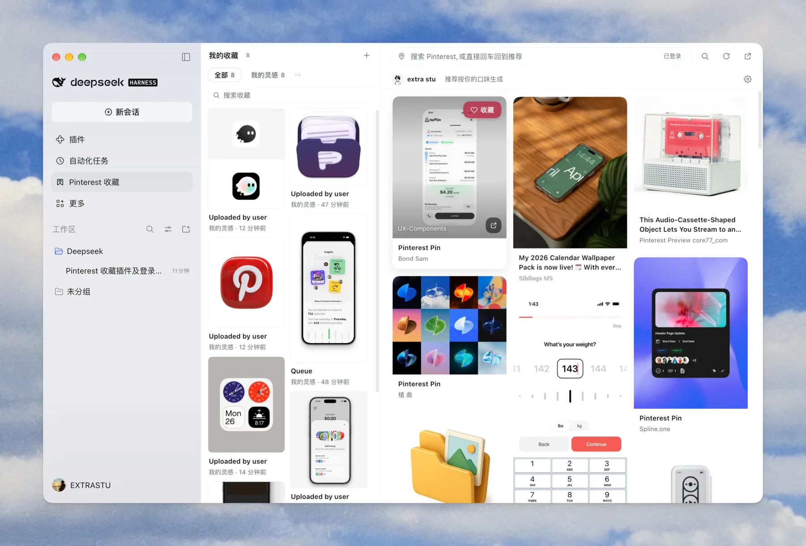

# Pinterest Collection · DeepSeek Harness plugin

<p>
  <a href="packages/plugin/README.en.md">Plugin docs (English)</a> ·
  <a href="packages/plugin/README.md">中文</a> ·
  <a href="packages/website/README.md">Website docs</a> ·
  <a href="https://pinterestcollect.pages.dev/">Live site ↗</a>
</p>

> A DeepSeek Harness panel plugin that puts your Pinterest saves and personalized feed inside the harness, plus a zero-build marketing site.

<p align="center">
  
</p>

<p align="center"><sub>Your saves on the left · a personalized feed on the right · hit ♥ to save</sub></p>

## Monorepo layout

| Location | What it is | Docs |
|---|---|---|
| Repository root (package `pinterest-collect`) | **Install entry**: `dsh.bundle` / `dsh.client` declarations, bundle patch and module exports | this README |
| [`packages/plugin`](packages/plugin) | **Plugin source**: local saves, Pinterest browsing + logged-in feed, account page, settings | [English](packages/plugin/README.en.md) · [中文](packages/plugin/README.md) · [contract](packages/plugin/CONTRACT.md) |
| [`packages/website`](packages/website) | **Website**: static, bilingual, responsive, SEO built in (OG / hreflang / JSON-LD / sitemap) | [website/README.md](packages/website/README.md) |
| [`docs/`](docs) | README screenshots and static assets | — |

```
pinterest-collect/
├─ packages/
│  ├─ plugin/        # plugin source
│  └─ website/       # static marketing site
├─ docs/             # README screenshots and assets
├─ index.js          # install entry: forwards the Host exports from packages/plugin
├─ cordis.patch.yml  # install entry bundle patch
├─ package.json      # install entry (pinterest-collect) + workspace root
└─ pnpm-workspace.yaml
```

## Install the plugin

The repository root is the installable bundle entry (`package.json` declares `dsh.bundle` / `dsh.client` and exports into `packages/plugin`), so you can install straight from GitHub:

```text
plugin_manager {
  action: "install_bundle",
  target: "github:extrastu/pinterest-collect"
}
```

For local development the absolute repository path works the same way (do not point at `packages/plugin` — that is the source package and declares no bundle):

```text
plugin_manager {
  action: "install_bundle",
  target: "/absolute/path/to/pinterest-collect"
}
```

Restart Harness once and refresh the page; a “Pinterest Collection” icon appears in the sidebar.

> Monorepo layout: the install entry is the **repository root**, the plugin implementation lives in `packages/plugin`, the website in `packages/website`.
> Full install, sign-in, usage and troubleshooting: [packages/plugin/README.en.md](packages/plugin/README.en.md).

## Website

Live: **https://pinterestcollect.pages.dev/** (English at `/en/`, deployed on Cloudflare Pages).

Local preview:

```bash
python3 -m http.server 8080 --directory packages/website
```

Open http://localhost:8080. Deployment notes: [packages/website/README.md](packages/website/README.md).

## Development

Node.js ≥ 22 required (pnpm is optional, used for workspace management).

```bash
pnpm install        # optional
pnpm build          # rebuild packages/plugin/client.js
pnpm test           # host routes + fetch client tests
pnpm test:login     # CDP login pipeline + two-phase login (headless)
pnpm check          # install / API / static compliance checks
pnpm serve:website  # local preview of the website
```

Or call the scripts directly:

```bash
node packages/plugin/build-client.mjs
node packages/plugin/tools/host-api-test.mjs
node packages/plugin/tools/verify/check.mjs
```

Conventions: plain JS client parts (no JSX), theme-token colors only, all user-facing strings flow through `pcT` with English dictionaries — see [packages/plugin/CONTRACT.md](packages/plugin/CONTRACT.md).

## Related app

[Post Saver](https://apps.apple.com/app/apple-store/id6816399878?pt=128665559&ct=pinterest-collect&mt=8) — save posts from 23 platforms on iPhone / iPad.

## License

Released under the [MIT License](LICENSE).

## Disclaimer

Unofficial third-party plugin, not affiliated with Pinterest. It reads data through Pinterest's web endpoints, which may be subject to their Terms of Service; use it for personal use and at your own risk.
