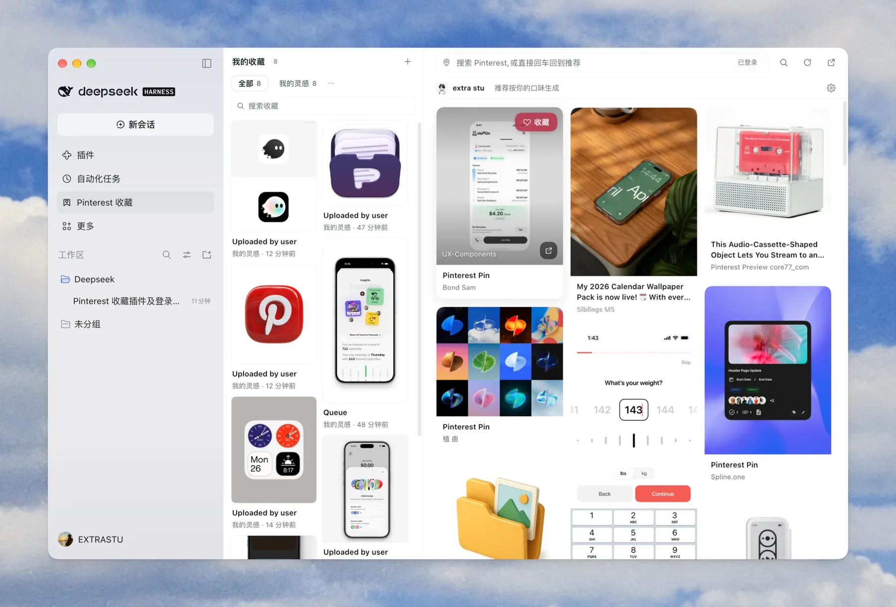

# Pinterest 收藏 · DeepSeek Harness 插件

<p>
  <a href="packages/plugin/README.md">插件文档(中文)</a> ·
  <a href="packages/plugin/README.en.md">English</a> ·
  <a href="packages/website/README.md">官网文档</a> ·
  <a href="https://pinterestcollect.pages.dev/">官网 ↗</a>
</p>

> 一个把 Pinterest 收藏夹和个性化推荐流放进 DeepSeek Harness 的面板插件;附带一个零构建的官网。

<p align="center">
  
</p>

<p align="center"><sub>左侧收藏 · 右侧个性化推荐流 · 看到喜欢的图点 ♥ 即收藏</sub></p>

## 仓库结构(monorepo)

| 位置 | 说明 | 文档 |
|---|---|---|
| 仓库根(包名 `pinterest-collect`) | **安装入口**:`dsh.bundle` / `dsh.client` 声明、bundle patch 与模块导出 | 本 README |
| [`packages/plugin`](packages/plugin) | **插件源码**:左侧本地收藏夹、右侧 Pinterest 浏览与登录推荐流、账号页、设置页 | [中文](packages/plugin/README.md) · [English](packages/plugin/README.en.md) · [契约](packages/plugin/CONTRACT.md) |
| [`packages/website`](packages/website) | **官网**:纯静态、中英双语、响应式、内置 SEO(OG / hreflang / JSON-LD / sitemap) | [website/README.md](packages/website/README.md) |
| [`docs/`](docs) | README 截图等静态资源 | — |

```
pinterest-collect/
├─ packages/
│  ├─ plugin/        # 插件源码
│  └─ website/       # 静态官网
├─ docs/             # README 效果图等资源
├─ index.js          # 安装入口:转发 packages/plugin 的 Host 导出
├─ cordis.patch.yml  # 安装入口的 bundle patch
├─ package.json      # 安装入口(pinterest-collect)+ workspace 根
└─ pnpm-workspace.yaml
```

## 安装插件

仓库根就是可安装的 bundle 入口(`package.json` 声明 `dsh.bundle` / `dsh.client`,模块导出指向 `packages/plugin`)。可以直接从 GitHub 安装:

```text
plugin_manager {
  action: "install_bundle",
  target: "github:extrastu/pinterest-collect"
}
```

本地开发时指向仓库绝对路径也一样(不要指向 `packages/plugin`,那是源码包,没有声明 bundle):

```text
plugin_manager {
  action: "install_bundle",
  target: "/absolute/path/to/pinterest-collect"
}
```

然后重启一次 Harness 并刷新页面,侧边栏会出现「Pinterest 收藏」图标。

> monorepo 布局:安装入口在**仓库根**,插件实现在 `packages/plugin`,官网在 `packages/website`。
> 详细安装、登录、使用与排错见 [packages/plugin/README.md](packages/plugin/README.md)。

## 官网

线上地址:**https://pinterestcollect.pages.dev/**(英文 `/en/`,Cloudflare Pages 部署)。

本地预览:

```bash
python3 -m http.server 8080 --directory packages/website
```

打开 http://localhost:8080。部署说明见 [packages/website/README.md](packages/website/README.md)。

## 开发

需要 Node.js ≥ 22(pnpm 可选,只用于 workspace 管理)。

```bash
# 可选:让 pnpm 识别 workspace
pnpm install

pnpm build          # 重新生成 packages/plugin/client.js
pnpm test           # Host 路由 + 抓取客户端测试
pnpm test:login     # Chrome 登录管道 + 两段式登录测试(headless)
pnpm check          # 安装 / 接口 / 静态合规检查
pnpm serve:website  # 本地预览官网
```

也可以直接调用脚本:

```bash
node packages/plugin/build-client.mjs
node packages/plugin/tools/host-api-test.mjs
node packages/plugin/tools/verify/check.mjs
```

约定:客户端是普通 JS 片段(无 JSX)、颜色只用主题 token、文案走 `pcT`、新增文案要补英文词典——详见 [packages/plugin/CONTRACT.md](packages/plugin/CONTRACT.md)。

## 相关 App

[Post Saver](https://apps.apple.com/cn/app/post-saver-save-social-posts/id6816399878?ct=pinterest-collect-github)——在 iPhone / iPad 上保存 23 个平台的帖子。

## 许可证

本项目采用 [MIT License](LICENSE)。

## 免责声明

非官方第三方插件,与 Pinterest 无关联。插件通过 Pinterest Web 接口读取数据,可能受其服务条款约束,请用于个人自用并自行承担账号风控等风险。
