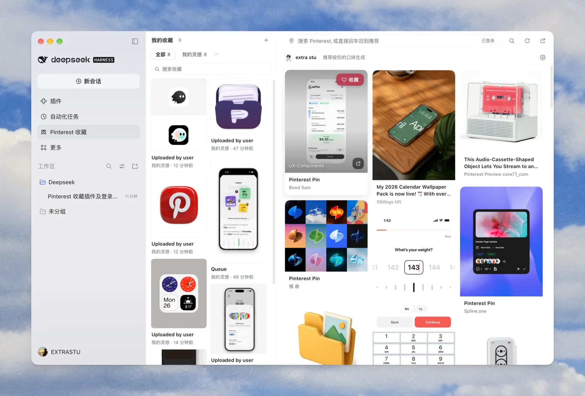

# Pinterest Collection · DeepSeek Harness plugin

**Your Pinterest saves on the left, a personalized Pinterest feed on the right. Hit ♥ on anything you like and it lands in your collection.**

<sub>v1.2.0 · DeepSeek Harness plugin · macOS / Windows / Linux · [中文](README.md)</sub>

<p align="center">
  
</p>

<p align="center"><sub>Your saves on the left · a personalized feed on the right · hit ♥ to save</sub></p>

---

## What it is

A panel plugin for DeepSeek Harness. It adds a `Pinterest Collection` icon to the sidebar, which opens a two-pane workspace:

- **Left pane** — your own collection (multiple boards, search, resizable).
- **Right pane** — a built-in Pinterest browser. After you sign in, it shows **the personalized home feed Pinterest generates for you**; you can also search, paste links, open details and save pins.
- Saving a pin drops it straight into the left pane; opening a pin switches the right pane to a full **detail page** with related recommendations below, so you never hit a dead end.

It is a native Harness panel rather than a separate website, so it follows the Harness theme, language and window chrome.

## Features

- **Two panes**: saves on the left, browsing on the right, draggable divider (arrow keys work too), width remembered.
- **Pinterest sign-in**: two-phase Chrome login (a clean Chrome window where you log in yourself, including Google / captcha / 2FA), or paste cookies by hand.
- **Personalized feed**: your own Pinterest home feed, infinite scroll, refresh for a new batch.
- **Search & links**: type a query, or paste a Pinterest search / board / profile URL.
- **Detail page (not a modal)**: large image, description, author, plus "More like this"; going back keeps your scroll position.
- **Board management**: create / rename / delete boards, filter by board, search inside saves, one-click unsave.
- **Account page**: click the avatar in the account bar to see the pins you made on Pinterest (your profile grid), and keep saving from there.
- **Settings page (two columns)**: a section list (Account / Appearance / Language / About) on the left and the selected section's details on the right; appearance (system / light / dark) and language (Chinese / English) are written back to Harness and persisted. The About section also hosts a "Related app" card (see below).
- **Polish**: macOS hidden-titlebar safe area, bilingual UI, dark theme, keyboard/ARIA accessibility.

## Why not an `<iframe src="pinterest.com">`?

Pinterest sends `X-Frame-Options: SAMEORIGIN`, so browsers refuse to embed it. The "webview" is therefore built from two halves:

- **Host (Node)**: replays Pinterest's own web read path (bootstrap `csrftoken`, then call `resource/*Resource/get`), normalizes results into a unified `Pin`, and — once you sign in — fetches your personalized home feed with your cookies.
- **Browser (React)**: renders the address bar, masonry feed, detail page and account page.

Pinterest's related-pins and user-pin-grid data is not a public REST API either; the plugin uses the same web resources Pinterest's own frontend uses (with your session). **If Pinterest changes them, this part may break** — several candidate endpoints and fallbacks are in place, but long-term stability is not guaranteed.

## Installation

### Requirements

- DeepSeek Harness (desktop or web) with a profile that supports plugin bundles.
- One-click login needs **Chrome / Chromium / Edge / Brave** on the machine (macOS with Chrome 156 is tested). Without Chrome, use the cookie-paste fallback.
- Node.js ≥ 22 for development and tests.

### Steps

The repository **root is the install entry** (its `package.json` declares `dsh.bundle` / `dsh.client` and exports into this package), so you can install straight from GitHub:

```text
plugin_manager {
  action: "install_bundle",
  target: "github:extrastu/pinterest-collect"
}
```

For local development, use the absolute repository path (point at the root, not at `packages/plugin`):

```text
plugin_manager {
  action: "install_bundle",
  target: "/absolute/path/to/pinterest-collect"
}
```

Then:

1. **Restart Harness once** (the Host half's JS is loaded once per process; toggling the plugin off/on also works);
2. **Refresh the page** (⌘R / Ctrl+R);
3. Click the new `Pinterest Collection` sidebar icon.

> This repository is a monorepo: **the install entry is the repository root, and the plugin source lives in `packages/plugin`**. Pointing at `packages/plugin` fails with “declares no bundle” because that source package declares no `dsh.bundle`.
> The plugin is installed from a local directory. After editing: rebuild the client and refresh for client changes; restart Harness (or toggle the plugin) for Host changes.

## Usage

1. Click the **Pinterest Collection** icon in the sidebar.
2. On first run the right pane asks you to sign in:
   - **One-click login (recommended)**: opens a separate Chrome window → sign in there (Google login works) → click **"I'm done, continue"** in the panel (or ⌘Q that Chrome window) → the plugin reads the session automatically.
   - **Paste cookies**: sign in to pinterest.com in your own browser, copy `_pinterest_sess` / `csrftoken` / `_auth` from DevTools → Application → Cookies, and paste them as one line.
3. The right pane becomes your personalized feed; the address bar searches, the top-right button refreshes.
4. Hover any pin → **Save**; click it → detail page with "More like this".
5. Manage boards on the left: `+` creates (inline input), `⋯` renames/deletes, the search box only searches your saves.
6. Click the **avatar** in the account bar for the account page; click the gear for **settings** (appearance / language / account).
7. **Note why you saved it**: on the detail page, under the save button, write a one-liner (e.g. "love this palette", "borrow this button layout"). Notes show on the collection cards and are included in collection search.
8. **Export data**: Settings → About → “Export data” downloads your boards, saves and notes as a JSON file (no login cookie) for backup or migration.

## How sign-in works (and why no debug port)

Pinterest offers no anonymous recommendation API, so recommendations require your session. The plugin never touches your password:

1. **Phase A**: a clean Chrome window **without any debugging/automation flags** opens the Pinterest login page; you sign in normally. Recent Chrome sets `navigator.webdriver = true` when launched with `--remote-debugging-port`, which makes Google refuse sign-in with "this browser or app may not be secure" — that was a real bug in early versions, hence the deliberately clean login window.
2. **Phase B**: after you click continue or quit Chrome, the plugin launches a one-off headless instance on the same profile, reads only the Pinterest cookies, and closes it. It never touches Google pages.

Security boundaries:

- The session cookie is written only to `~/.dsh/pinterest-collect/session.json` (mode `600`).
- One-click login uses a dedicated Chrome profile (`chrome-profile`); your everyday browser session is never touched.
- You can sign out from the panel at any time; only the local cookie is deleted.
- Network requests go only to `pinterest.com` / `pinimg.com`; nothing is uploaded elsewhere.

## Data & privacy

| Data | Location | Notes |
|---|---|---|
| Saves | `~/.dsh/pinterest-collect/collection.json` | atomic writes; override with `DSH_HOME` or plugin `config.dataDir` |
| Session | `~/.dsh/pinterest-collect/session.json` | mode `600`, removed on sign-out |
| Chrome profile | `~/.dsh/pinterest-collect/chrome-profile/` | dedicated, reusable |
| Pin images | Pinterest CDN (`i.pinimg.com`) | rendered only, not downloaded |
| Related-app icon | Inlined data URI in `client.js` | no extra network request; only a click navigates to the App Store |

The plugin does **not** read your Pinterest password and does **not** write saves back to your Pinterest account (see limitations).

## Architecture

```
┌──────────────────────── Host (index.js + lib/) ───────────────────────┐
│ /pinterest-api/*   same-origin HTTP bridge                              │
│ collections        collection.json (atomic writes)                     │
│ Pinterest client   lib/pinterest.mjs: cookies, CSRF, paging, feed, pins│
│ sign-in            lib/browser-login.mjs: two-phase Chrome CDP login   │
└───────────────────────────────┬────────────────────────────────────────┘
                                │ fetch (same origin)
┌───────────────────────────────┴────────────────────────────────────────┐
│ Client (client.js, React, slot panel)                                  │
│ left: CollectionPane   right: BrowsePane (feed / search)               │
│ overlays: pin detail · account page · settings page · login dialog     │
│ theme-token styles + tiny i18n (pcT)                                   │
└────────────────────────────────────────────────────────────────────────┘
```

### Repository layout

| Path | Purpose |
|---|---|
| `index.js` | Host plugin: `/pinterest-api` routes, saves, login jobs, account/feed/pins endpoints |
| `lib/pinterest.mjs` | Pinterest fetch client (cookies, CSRF, paging, retries, normalization, feed, user pins) |
| `lib/browser-login.mjs` | Zero-dependency Chrome CDP login (two-phase) |
| `src/client/parts/00-shared.js` | React handles, `pcFetch`, icons, avatar, formatting |
| `src/client/parts/10-collection.js` | Left collection pane + board-name dialog |
| `src/client/parts/14-i18n.js` etc. | Tiny i18n and zh/en dictionaries |
| `src/client/parts/20-browser.js` | Right browser pane (feed / search / infinite scroll / account bar) |
| `src/client/parts/23-account.js` | Account page (my pins grid) |
| `src/client/parts/24-settings.js` | Settings page (account / appearance / language) |
| `src/client/parts/25-login.js` | Login dialog (one-click / paste cookies / sign out) |
| `src/client/parts/30-detail.js` | Pin detail page + related pins |
| `src/client/parts/90-app.js` | State, actions, split layout, toasts, slot registration |
| `src/client/panel.css` | All styles (theme tokens + few brand/neutral colors) |
| `client.js` | Generated browser module (do not edit by hand) |
| `build-client.mjs` | Concatenates parts + CSS into `client.js`, runs `node --check` |
| `CONTRACT.md` | Internal API / UI contract (read before contributing) |
| `tools/` | Test and verification scripts |
| `README.md` | Chinese documentation |

> The website is a separate monorepo package: [`../website/`](../website/) (deploy notes in its README).

## Development

> Commands below run inside `packages/plugin`; from the repository root you can also use `pnpm build` / `pnpm test` / `pnpm check`.

```bash
node build-client.mjs              # rebuild client.js (syntax checked)
node tools/host-api-test.mjs       # Host routes with a minimal ctx
node tools/host-fetch-test.mjs     # fetch client against real Pinterest
node tools/login-cdp-test.mjs      # Chrome CDP login pipeline (headless)
node tools/login-two-phase-test.mjs# two-phase login + no leftover processes
node tools/verify/check.mjs        # manifest / live API / static compliance
```

Conventions (see `CONTRACT.md`):

- Client parts are **plain JS fragments**, no JSX — components use `h(...)`; only `require('react')` is allowed, never import Harness Client packages.
- Colors must use `--dsw-alias-*` theme tokens (brand red / neutral overlays are the only exceptions).
- User-visible strings go through `pcT('中文原文', { vars })`; English dictionaries live in `17/16/19-i18n-*.js`.
- Do not write DOM outside your component or read other plugins' DOM.

## Website

Live: **https://pinterestcollect.pages.dev/** (English at `/en/`).

The monorepo's [`../website/`](../website/) is a zero-build static site: Chinese at `/`, English at `/en/`, responsive, light/dark, copy-to-clipboard install snippet, and SEO baked in (canonical / hreflang / Open Graph / `SoftwareApplication` + `WebSite` + `FAQPage` JSON-LD / sitemap / robots).

```bash
# run from the repository root
python3 -m http.server 8080 --directory packages/website
```

Deployment and placeholder replacement (domain, GitHub URL) are documented in [`../website/README.md`](../website/README.md).

## Tests

| Command | Coverage | Status |
|---|---|---|
| `node tools/host-api-test.mjs` | Host routes offscreen (including real Pinterest search and note read/write) | 34 passing |
| `node tools/host-fetch-test.mjs` | Fetch client against real network (paging, retries, error mapping) | 210 assertions |
| `node tools/login-cdp-test.mjs` | CDP login pipeline (headless, no window) | 22 passing |
| `node tools/login-two-phase-test.mjs` | Two-phase login, no debug port in phase A, no leftover processes | 16 passing |
| `node tools/verify/check.mjs` | Install / manifest / live API / static compliance | 15 checks (credential checks SKIP while signed in) |

## Troubleshooting

**Google says "this browser or app may not be secure" during login.**
That was the debug-port issue in early versions; v1.2 uses the clean two-phase window. Make sure you are running the latest code and refreshed/reloaded the plugin.

**Feed is empty or says it cannot be read.**
Pinterest's web resources change or rate-limit. Click "re-check" on the account/settings page or sign in again. If it persists, open an issue with the `/pinterest-api/account` payload and the panel message.

**The panel is blank.**
The client has an error boundary that normally shows "panel crashed / retry". If it is completely blank, refresh the page; after Host edits, restart Harness.

**Pasting a single pin URL does nothing.**
Single-pin data requires a session and Pinterest has no stable anonymous detail endpoint; search by keywords instead.

**Are saves synced to my Pinterest account?**
No. Saves are local; each detail page has "Open on Pinterest" for manual saving. Account-level writes would need Pinterest OAuth (future work).

## Known limitations

1. No write-back to the Pinterest account (would need OAuth / write scopes).
2. Feed, user pins and related pins rely on Pinterest web resources and may break when Pinterest changes them.
3. "More like this" is a fallback (search by title/description, excluding the current pin), less relevant than the official closeup.
4. One-click login requires Chrome locally; Windows/Linux browser detection is not thoroughly verified.
5. Single-pin URLs are not supported directly; expired sessions require signing in again.
6. UI text is Chinese-source + English translations; new strings must be added to the dictionaries or English falls back to Chinese.

## Contributing

- Read `CONTRACT.md` first.
- Run `node build-client.mjs` plus the tests above.
- Never commit personal data from `~/.dsh/pinterest-collect/` (session, collection, chrome-profile).
- Add new UI strings to `src/client/parts/*-i18n-*.js`.
- In PRs, explain the motivation, how you verified it, and include screenshots for visual changes.

## Related app

**Post Saver: Save Social Posts** (iPhone / iPad) — save posts from **23 platforms** (X, Threads, Instagram, YouTube, Xiaohongshu, Weibo, Pinterest, and more) as clean text / images / video: [download on the App Store](https://apps.apple.com/app/apple-store/id6816399878?pt=128665559&ct=pinterest-collect&mt=8).

The same entry sits under **Settings → About** in the plugin (with `pt`/`ct` for attribution); its icon is inlined, so it costs no extra request.

## Disclaimer

Unofficial third-party plugin, not affiliated with Pinterest. It reads data through Pinterest's own web endpoints, which may be subject to Pinterest's Terms of Service. Use it for personal/learning purposes and at your own risk (including account risk controls). Pinterest and its logo are trademarks of Pinterest, Inc.

## License

Released under the [MIT License](../../LICENSE).
